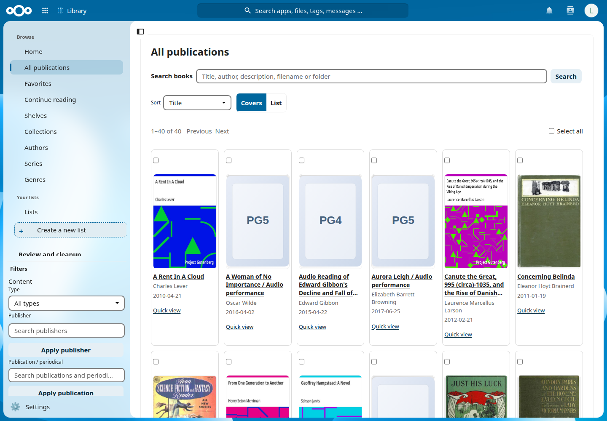
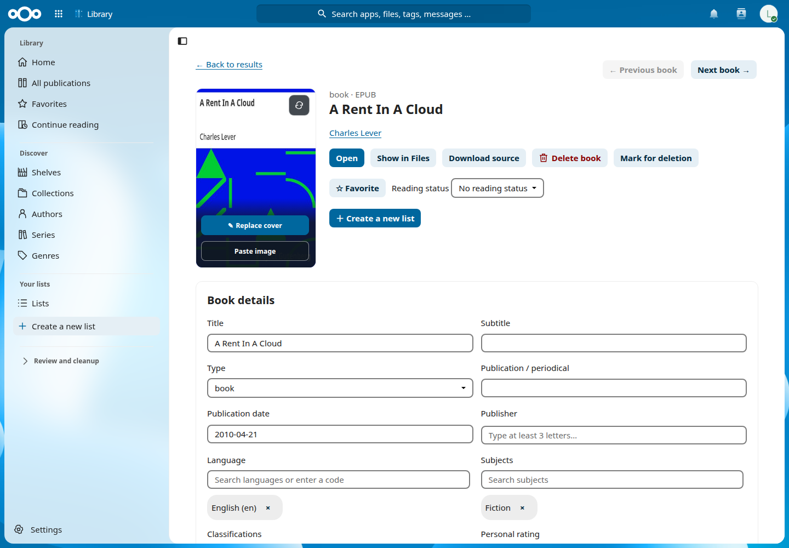
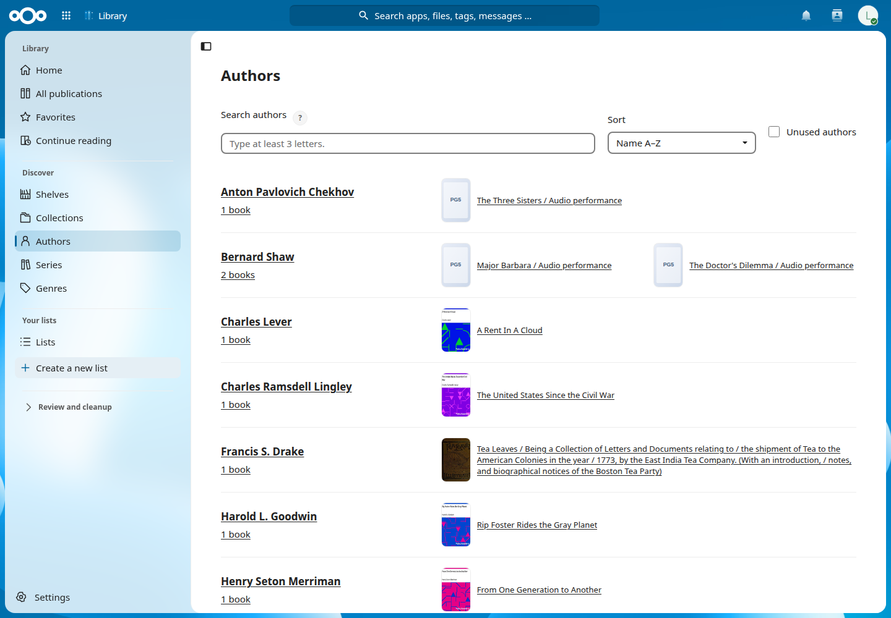
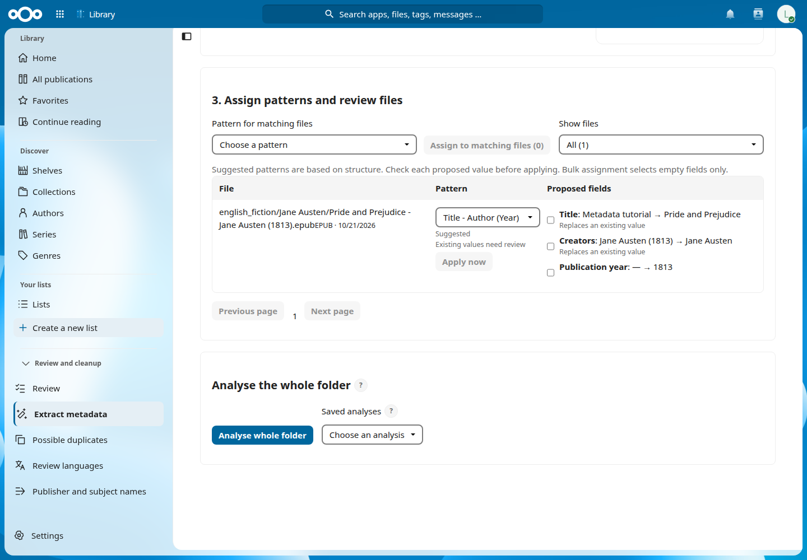

# Library

Browse, organise and improve the books, comics, magazines and papers you already keep in Nextcloud Files.

Library is an open-source Nextcloud app ([AGPL-3.0-or-later](LICENSE)) with a searchable cover gallery, author/series/genre browsing, private reading lists and tools for reviewing messy metadata. Nextcloud Files remains the canonical storage: a file-ID-based index connects your existing files to the catalogue.



Current developer build: `0.3.0-alpha.38`. **Pre-release:** 0.3 is the planned first App Store release. The declared compatibility range is **Nextcloud 33–35**; final exact-package compatibility checks and human acceptance remain release gates. Earlier signed candidates have their own verification records. See [release status](RELEASE.md), the [deployed verification record](docs/compatibility-evidence/2026-10-21-nc34-alpha38/README.md) and the [release checklist](docs/app-store-readiness.md).

## What it does

- scan folders already visible in Nextcloud Files; browse covers or a list with shelves and saved filter collections;
- search and filter titles, linked author names, series, descriptions, identifiers, file names and folders;
- filter by type, format, year, author, publisher, subject, classification, tag, scan state, workflow state and review flags;
- use typeahead for authors, publishers, series, genres, languages, subjects and other catalogue facets;
- maintain private reading lists with ordered books and notes;
- browse authors, series and genres with sorting and linked book previews; edit author profiles and review reassignment, merges and imported relationship changes;
- infer metadata from paths and filenames with a pattern per file, bulk matching, one reviewed Apply and Undo;
- schedule scans, review optional potential-duplicate suggestions and reopen saved filter collections;
- open books in a new tab through the installed Nextcloud viewer, show them in Files or use **Download**;
- edit book details with a single Save/Discard workflow, preserve corrected fields during scans, and manage favorites, ratings, reading status and file comments;
- review weak metadata, scanner conflicts, missing files and metadata extraction errors;
- export corrected metadata and preview imports before applying them;
- delete a book file after confirmation, retaining shared OPF metadata and other companion files and removing its immediate parent only when safely empty and unprotected.

The app has safe user-facing diagnostics for scan and metadata problems. Server logs keep the technical detail.
## A look inside

**Book details:** title, metadata, cover actions and linked authors in one editor. Changes to book metadata remain a draft until saved.



**Authors:** browse names and their books, sort the directory and open a profile or book directly.



**Extract metadata:** assign a pattern to each file or matching group, then preview and approve selected fields together. See the [extraction guide](docs/extracting-metadata.md).



Screenshots show the actual alpha.38 interface on an isolated Nextcloud 34 instance, using the [English Gutenberg examples](docs/gutenberg-example-books.md) and a synthetic filename-extraction example. [Capture details and reproduction](docs/images/first-library/README.md).

## Your first library

1. Upload a few EPUB, PDF or CBZ files to a folder in Nextcloud Files.
2. Open **Library → Settings → Folders and scanning**, choose **Add a shelf**, select the folder and click **Save shelf**.
3. Click **Scan this shelf** and wait for the background scan to finish.
4. Open **All publications**. Click a cover/title for Book details or **Quick view** for the sidebar; **Open** hands the file to your installed viewer.

Follow [Your first library](docs/first-library.md) for a screenshot walkthrough. EPUB/comic reading depends on the viewer apps installed on your server; downloading the source remains available.

## Current scope

Library keeps source files in place. Scans and edits write to Library-owned tables and metadata records. Metadata import has a preview step before anything is applied.

The explicit **Delete book** action removes the selected source file through Nextcloud; normal scanning and metadata editing do not rewrite it. Corrected-metadata export is a **partial export**, not a backup of lists, author profiles or all relationships. Use the [backup and recovery guide](docs/recovery.md) to preserve the complete Library state.

Outside 0.3: a built-in reader, reading-position sync or annotations, OCR/full-text document search, internet metadata lookup, OPDS/device sync, AI classification and shared/admin-managed roots.

## Install

As a Nextcloud administrator:

```bash
tar -xzf library-<version>.tar.gz -C /var/www/html/custom_apps
chown -R www-data:www-data /var/www/html/custom_apps/library
sudo -u www-data php /var/www/html/occ app:enable library
```

The archive must contain one top-level `library/` directory. Adjust paths and the web-server user for your installation; containers can use `docker exec`. Nextcloud background jobs must run for queued scans; Cron is recommended for scheduled scans.

## Try it

From a source checkout with Node 24/npm 11:

```bash
npm ci
scripts/package-release.sh
```

Install `dist/library-<version>.tar.gz` with the archive commands above. Verify a packaged candidate with its adjacent `.sha256` artifact; detailed release evidence stays in the excluded `RELEASE.md`.

Checks: `npm run check` and `npm run smoke:release-package`. For GUI workflows, install the pinned browsers with `npx playwright install chromium firefox`, then run `npm run test:gui` against a configured disposable instance. [Browser setup and coverage](docs/playwright-journeys.md).

`bin/nextcloud-background-worker.sh` runs the general Nextcloud background worker for a bounded development pass.

## What's next

The [Active roadmap](docs/roadmap.md) keeps 0.3 focused on release readiness. Planned later themes are **0.4 Enrich and discover**, **0.5 Read and remember**, and **0.6 Explore your knowledge**, including optional metadata providers, deeper Nextcloud/reader integration and grounded content discovery. These are future plans, not features of this candidate.

## More documentation

- [Your first library](docs/first-library.md) — configure a folder, scan Gutenberg books and browse your first catalogue.
- [User and admin guide](docs/user-guide.md), [FAQ and troubleshooting](docs/faq.md), [Playwright journey coverage](docs/playwright-journeys.md), [Human test handbook](docs/human-test-handbook.md), [Public alpha test checklist](docs/alpha-test-checklist.md)
- [Current state and risk register](docs/current-state-and-risk-register.md), [Active roadmap](docs/roadmap.md), [Post-v0.1 roadmap](docs/post-v0.1-roadmap.md), [Personal top features scope](docs/personal-top-features.md)
- [Product concept](docs/product-concept.md), [UX concept](docs/ux-concept.md), [Usefulness and UX feature list](docs/usefulness-and-ux-feature-list.md)
- [Reusable Nextcloud UI starter](docs/nextcloud-ui-starter.md) and [app architecture guidelines](docs/nextcloud-app-guidelines.md) — lessons for new apps.
- [Release process](RELEASE.md), [Changelog](CHANGELOG.md), [App Store listing draft](docs/app-store-listing.md), [App Store readiness roadmap](docs/app-store-readiness.md)
- [Database schema reference](docs/database-schema.md), [Metadata storage and Nextcloud integration](docs/metadata-storage.md), [Human architecture review notes](docs/architecture-review.md)
