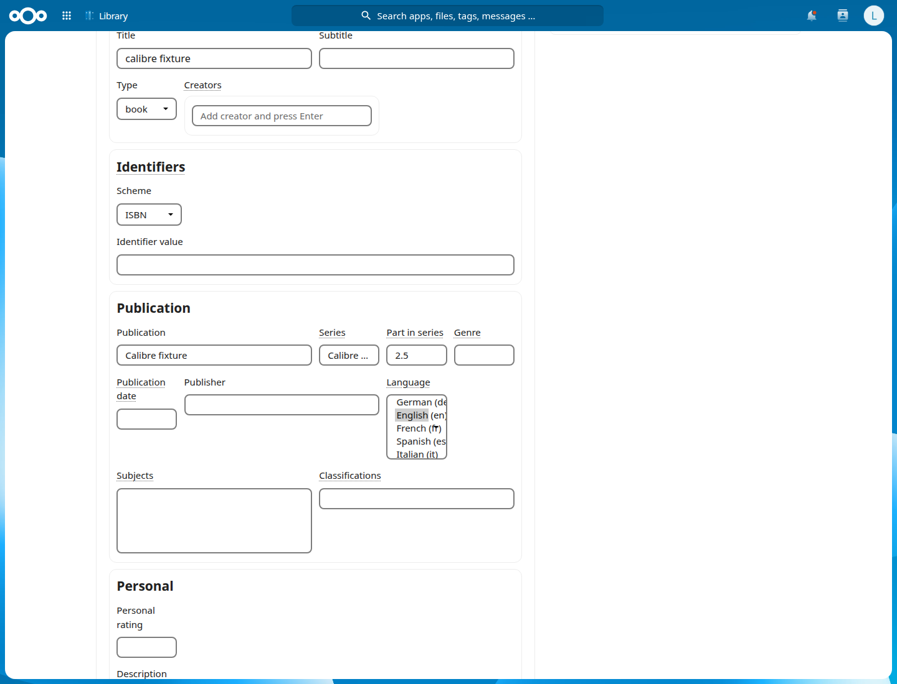
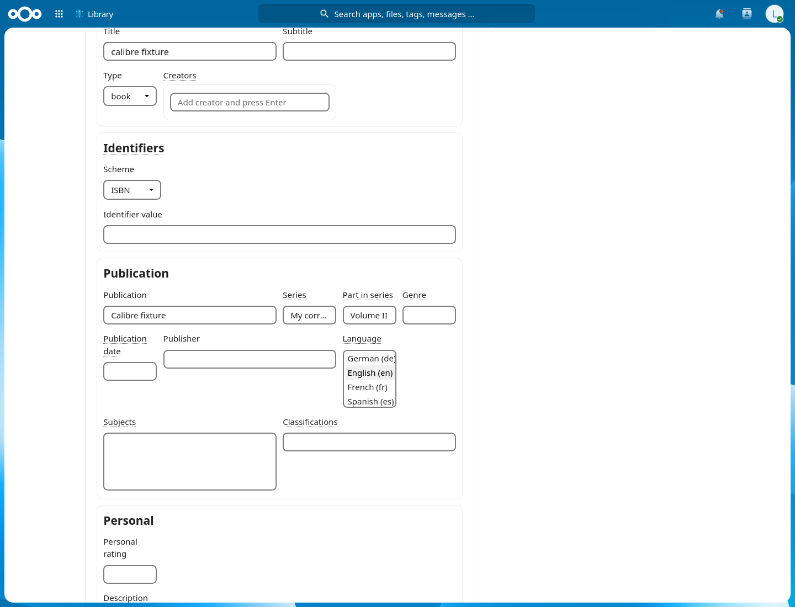

# Beta 2 series metadata verification

Library `0.2.0-beta.2` imports Calibre and EPUB 3 series names and positions into the dedicated catalogue fields. Developer deployment, browser verification, full-refresh observation and all six NC33–35 release cases passed. The signed archive is ready for owner acceptance; it has not been published.

## Candidate

- Source commit: `fa5f62c` on `develop/0.2`.
- Archive: `dist/library-0.2.0-beta.2.tar.gz`.
- SHA256: `772160d4eee8bbdf5dcff9c317ffdd170a29922be884217b4373fda21db30bae`.
- Embedded Nextcloud signature, package audit, SBOM, provenance and detached App Store signature verified locally.
- The signed beta.1 archive remains unchanged. Beta.2 has not been published or submitted to the App Store.

## Local checks

The complete `scripts/check.sh` gate passed: 1,044 Python tests, 531 frontend tests in 36 files, the PHP runtime suite, 518 inference parser vectors, translation checks, production build, local Markdown links and diff hygiene. After adding the disposable-login regression assertion, the full Python suite passed 1,045 tests. The new series runtime test contains 26 assertions covering Calibre positions, EPUB 3 references and collection types, missing values, and sidecar precedence.

The documentation heading assertion was updated to match the existing historical v0.1 section. Cache tests now require re-extraction when upgrading from an older metadata pipeline; beta.2 must not adopt old series candidates unchanged.

## Dependency audit

The initial candidate triggered npm audit findings for DOMPurify and source-map-js. Their compatible updates are locked to DOMPurify 3.4.17 and source-map-js 1.2.2. The resulting production dependency audit reports zero vulnerabilities. Packaging now runs the audit before building or signing. See the [DOMPurify advisory](https://github.com/cure53/DOMPurify/security/advisories/GHSA-6688-9rhm-gjv2) and [source-map-js advisory](https://github.com/advisories/GHSA-68fv-2mgg-jv7q).

The initial archive and interrupted compatibility runs are retained under `/tmp/library-beta2/superseded-archive` and `/tmp/library-beta2/matrix-initial-*`. They are excluded from the final candidate results.

## Developer Nextcloud 34

The server runs Nextcloud 34.0.3 with MariaDB. The importer PHP files were first deployed with rollback copies and HTTP opcode invalidation. After the scheduled refresh completed, the final signed archive was installed, HTTP workers were recycled, and the installed version and clean Nextcloud app integrity report were checked. Chromium, Firefox and the real-book browser checks passed again after this deployment.

Nextcloud’s `occ upgrade` also automatically updated the separate EPUB Viewer app to 1.9.8. That app update is a developer-server deployment side effect, not part of the Library archive. Nextcloud reports no embedded EPUB Viewer signature and skips its integrity check; Library’s own integrity check passes.

A targeted scan of 40 actual English-fiction books matched the new extractor's series candidates, reported zero metadata warnings, and retained file etag/mtime/size markers. Six books had series names; five also supplied positions. A read-only Chromium pass verified the six series-bearing detail pages. Private real-book screenshots and item IDs are retained outside the repository under `/tmp/library-beta2/real-browser`.

A separate temporary account supplied Calibre and EPUB 3 fixtures. Chromium and Firefox both verified displayed series values, saved manual corrections, forced re-extraction through an older revision marker, and confirmed that corrections survived while scanner candidates were refreshed. Source markers remained unchanged. The account and its app password were deleted. See [browser results](developer-browser.json).





These are direct browser screenshots of synthetic fixtures, with no DOM styling or image retouching. The legacy detail form gives series fields relatively little horizontal space; text input values and persistence were checked independently of their visible clipping.

## Full refresh and compatibility matrix

| Nextcloud | Fresh install | Upgrade from beta.1 | Main Playwright tests |
| --- | --- | --- | --- |
| 33.0.9 | PASS | PASS | 35 + 35 |
| 34.0.4 | PASS | PASS after fixture correction | 35 + 35 |
| 35.0.0 | PASS | PASS | 35 + 35 |

The final matrix contains **210 passed main Playwright executions**, zero skipped, unexpected or flaky results. All six cases also passed package integrity, five service integrations, two-browser series checks, inference Apply/Undo, duplicate detection, inference suggestions and scheduled-scan checks. Every disposable instance was removed successfully. See [machine-readable results](results.json).


The scheduled full refresh passed: all seven enabled roots completed in 21.6 minutes, processing 7,140 publications. It extracted metadata for 7,100 files and reused the 40 already-refreshed sample records. There were zero scan errors; 736 corrupt/unsupported archive warnings matched the preceding run (727 CBZ and 9 EPUB). Source-file identity markers, existing manual corrections and the daily schedule interval were unchanged. After refresh, the available catalogue contains 441 records with series names and 439 with series positions; these totals include any existing manual values.

The refresh covers the developer's currently available sources. Before this run, the catalogue already held 107,717 rows, of which 100,577 had been marked missing; the preceding scan found 7,140 publications. This run must not be described as processing 107,717 available books.

Disposable release checks use Nextcloud 33.0.9, 34.0.4 and 35.0.0, with the same signed archive and 40 English Gutenberg books. Each version is exercised as a fresh installation and an upgrade from signed `0.2.0-beta.1`. The matrix includes integrity, service integrations, the complete Playwright suite, series-browser checks, inference, duplicate detection and scheduled scans.

### NC34 upgrade fixture correction

The first final-archive NC34 upgrade browser run stopped on Nextcloud's dashboard: 31 tests failed at the shared login assertion, before their Library interactions, while four passed. Failure screenshots showed the dashboard and logs reported missing recommendation previews. Those raw results are retained under `/tmp/library-beta2/failed-upgrade-34-dashboard`.

The disposable-instance setup now sets Nextcloud's supported `defaultapp` option to `library`, so authentication lands in the application under test. Browser error assertions are unchanged. The developer's default app was not changed. The complete NC34 upgrade rerun passed on the identical archive, including 35 main Playwright tests and every supplementary check. Its result is included in the final matrix.

## Coverage limits

Disposable installations use SQLite; the developer server uses MariaDB. PostgreSQL and manual screen-reader testing remain outside this run. The inherited detail form has narrow series controls; a layout improvement can be handled separately.

## Repeat the checks

```bash
PATH=/path/to/python-venv/bin:$PATH bash scripts/check.sh

NC_CONTAINER=nextcloud NC_URL=http://100.123.149.120:8088 \
  EVIDENCE_DIR=/tmp/library-series-check node scripts/smoke-opf-series.mjs

export LIBRARY_TEST_ARCHIVE="$PWD/dist/library-0.2.0-beta.2.tar.gz"
export LIBRARY_BOOK_FIXTURE_ARCHIVE=/path/to/gutenberg-en-40.tar.gz
export REQUIRE_INTEGRITY=1 PLAYWRIGHT_HTML_OPEN=never
INSTALL_MODE=fresh EVIDENCE_DIR=/tmp/library-beta2-fresh \
  bash scripts/performance/compatibility-matrix.sh
INSTALL_MODE=upgrade LIBRARY_BETA_ARCHIVE="$PWD/dist/library-0.2.0-beta.1.tar.gz" \
  EVIDENCE_DIR=/tmp/library-beta2-upgrade bash scripts/performance/compatibility-matrix.sh
```

The series smoke creates and deletes its own account. The matrix deletes its labelled disposable instances after each case. The Gutenberg archive should contain the 40 EPUB files at its top level. Changing the release archive invalidates the recorded checksum and requires new exact-package evidence.

## Handoff

The signed archive, checksum, detached App Store signature, SBOM and provenance are in `dist/`. Registration proof and instructions are in `dist/app-store-handoff-beta2/`. Developer Nextcloud is running beta.2 with maintenance mode off and no pending database upgrade.

Owner acceptance and public release/App Store submission remain. Before submission, verify that the release download and screenshot URLs are public; the screenshot references in the archive use the existing beta.1 tag. Beta.2 has not been uploaded to GitHub or submitted to the App Store in this run. Runtime source is committed as `fa5f62c`; later changes are documentation and the disposable test harness.

Final raw evidence is under `/tmp/library-beta2/final-{fresh,upgrade}-{version}/`. Developer evidence is under `/tmp/library-beta2/developer-final/`, `/tmp/library-beta2/real-browser/`, and `/tmp/library-beta2/full-refresh/`. Failed and superseded runs remain separate as described above.
