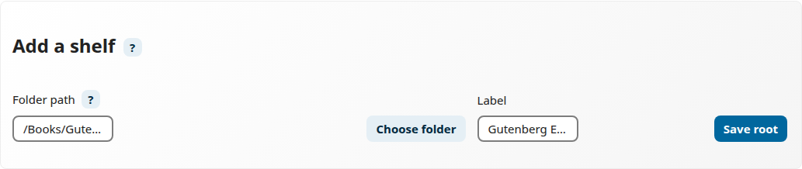
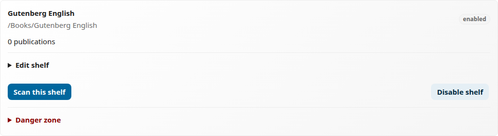
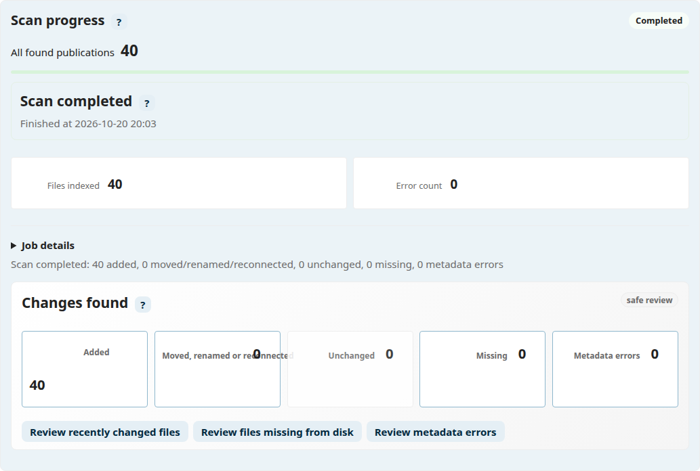
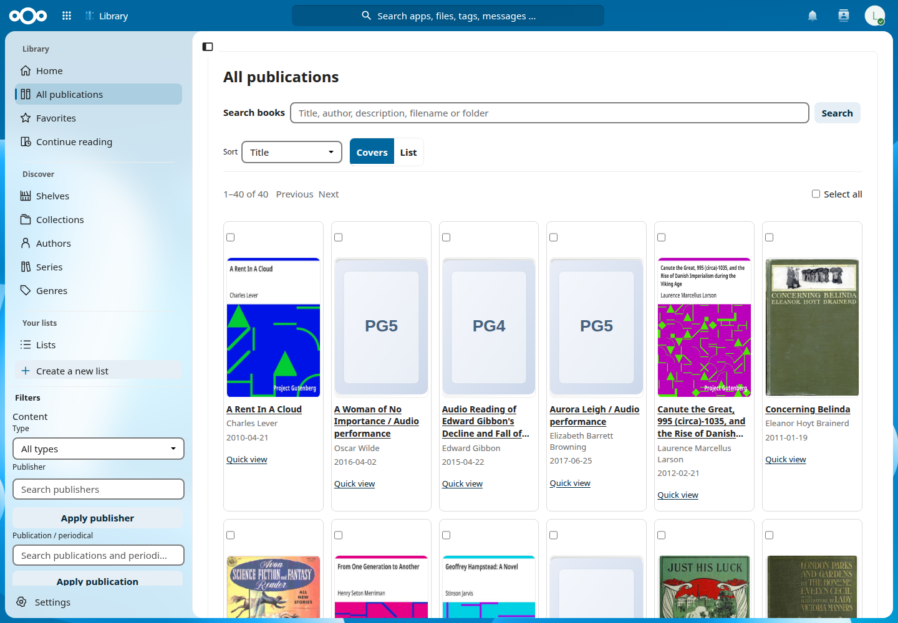
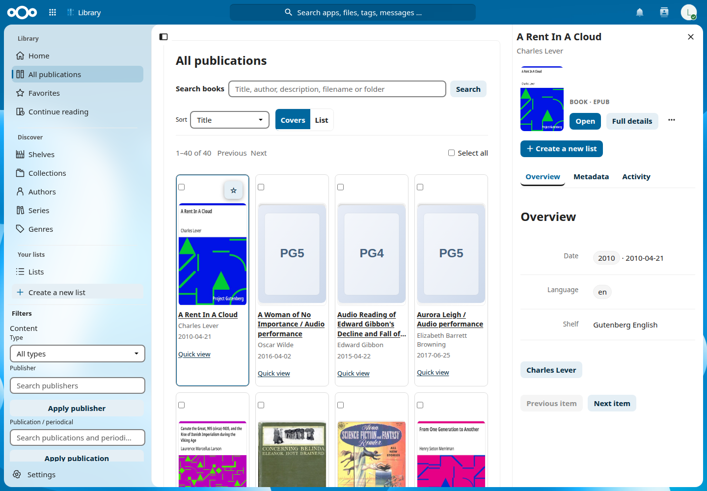
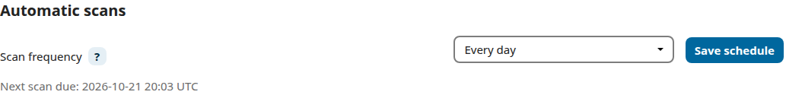

# Your first library

Turn a folder of English Project Gutenberg books into a catalogue you can search, browse and open. The instructions and screenshots use **0.3.0-alpha.35** on Nextcloud **34.0.4**, with 40 EPUB files. You can follow the steps with just a few books.

## Before you start

You need a Nextcloud account with the **Library** app enabled. Your administrator must also have Nextcloud background jobs running so queued scans can finish.

Choose a few EPUB downloads from the [Gutenberg example books](gutenberg-example-books.md). The screenshots use all 40 books in that list. Downloading books from Gutenberg and uploading them to Nextcloud are separate steps; Library scans files already stored in Nextcloud.

## Put your books in Nextcloud Files

1. Open **Files** in Nextcloud.
2. Create a folder called **Books**, then a folder inside it called **Gutenberg English**.
3. Upload your EPUB files there and wait for the uploads to finish.

Your folder path is now `/Books/Gutenberg English`. Keep the original filenames, such as `pg30645.epub`: Library can read titles and authors from the metadata inside an EPUB. You do not need to rename the files first.

## Add the folder to Library

1. Open **Library**, then **Settings** at the bottom of its left menu.
2. Under **Folders and scanning**, find **Add a shelf**.
3. Use **Choose folder**, or enter `/Books/Gutenberg English` in **Folder path**.
4. Enter **Gutenberg English** in **Label**, then click **Save shelf**.

A *root* is a folder Library scans, including its subfolders. Its label is the shelf name you see when browsing. Choose the folder as it appears in your Nextcloud Files, rather than a server filesystem path.

The saved folder should appear with an **enabled** badge and a **Scan this shelf** button. Saving the folder and scanning its books are separate actions.

## Scan your first books

1. Click **Scan this shelf** beside **Gutenberg English**.
2. Follow the scan progress on the settings page. It may be queued briefly before a background worker picks it up. You can leave the page and return later.
3. Wait for **completed**, then check the totals. With the full sample, you should find 40 publications.

Scanning reads your files, extracts metadata and builds Library's catalogue. It leaves the original EPUBs in their folder.

If the scan stays **queued**, ask your administrator to check Nextcloud's background jobs. If some files have metadata errors, use **Review** to investigate them; you do not need to fix every record before browsing.

## Browse and open a book

1. Return to **Library** and choose **All publications**.
2. Browse the covers, or search for a title such as **A Rent In A Cloud**. If you downloaded different books, search for one of their titles instead.
3. Try **Covers** and **List** to choose your preferred view. Use **Shelves** to browse a particular folder when you have more than one.
4. Click a cover or title to open **Book details**. Use **Quick view** on the card for the detail sidebar shown below.

The sidebar lets you inspect **Overview**, **Metadata** and **Activity**; author chips open the author's profile. **Open** launches the file in a new tab using the viewer available in your Nextcloud installation. If EPUB reading is unavailable there, use **Download** from the sidebar’s **…** menu and open it in your reading app.

Some books have a placeholder instead of an illustrated cover. That alone does not mean scanning failed. Clear any active search or filters if you cannot find a book you expected.

## Keep the catalogue up to date

In **Settings → Folders and scanning → Automatic scans**, choose **Every day** and click **Save schedule**. The first automatic scan is due after the chosen interval; **Scan this shelf** or **Scan enabled shelves** starts an immediate manual scan.

New or updated books are picked up by later scans. Missing files are marked as missing, and your manual Library metadata corrections are preserved. Reliable automatic scanning needs Nextcloud **Cron**, configured by your administrator.

You now have a working library. Add more folders when you are comfortable with the first one.

## Optional next steps

- [Create reading lists and add notes](v0.2-personal-lists.md).
- [Extract missing metadata from filenames and folders](extracting-metadata.md).
- [Review possible duplicates](duplicate-review.md).
- [Learn how automatic scans work](automatic-scans.md).
- [Troubleshoot missing books, queued scans or sparse metadata](faq.md).
